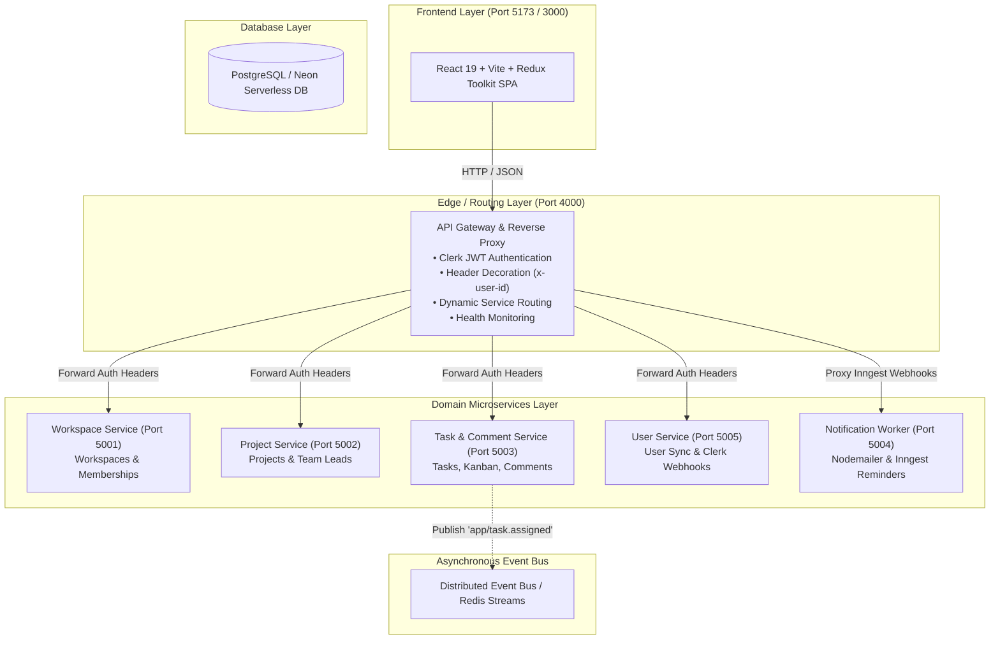

# 📋 TaskFlow — Microservices-Based Project Management Platform

## A modern, highly scalable full-stack project management application engineered using a **Microservices Architecture**, an **API Gateway**, an **Asynchronous Event-Driven Backbone**, and **Docker Container Orchestration**.

## 🌟 Key Features

- 🔐 **Edge Authentication** — Centralized Clerk JWT authentication and token validation at the API Gateway.
- 🏢 **Multi-Tenant Workspaces** — Workspace creation, custom slug generation, and role-based access control (`ADMIN` / `MEMBER`).
- 📁 **Project Management** — Milestone scheduling, progress tracking, deadline tracking, and team member assignment.
- ⚡ **High-Velocity Task Tracking** — Kanban status workflows (`TODO`, `IN_PROGRESS`, `DONE`), priority levels (`LOW`, `MEDIUM`, `HIGH`), and threaded comments.
- 📨 **Event-Driven Notifications** — Asynchronous task assignment emails and automated reminder workflows via Nodemailer and Inngest without blocking HTTP requests.
- 🐳 **Full Docker Orchestration** — Complete multi-container orchestration with Docker Compose, Redis event broker, and Nginx reverse proxy.

---

## 🏗️ System Architecture

TaskFlow decouples business logic across dedicated, single-responsibility microservices fronted by an API Gateway.

